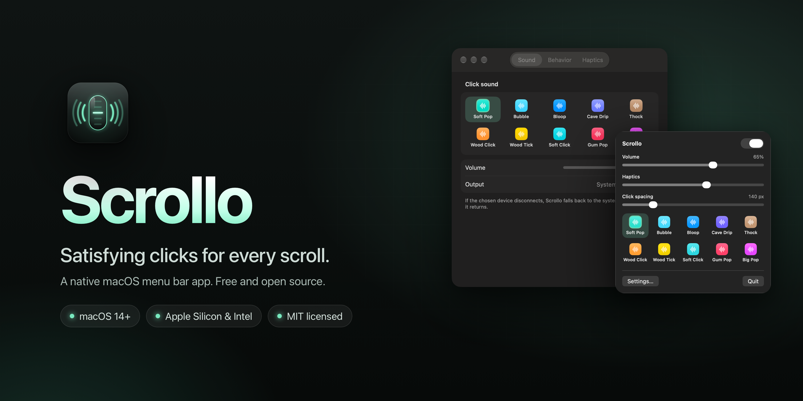
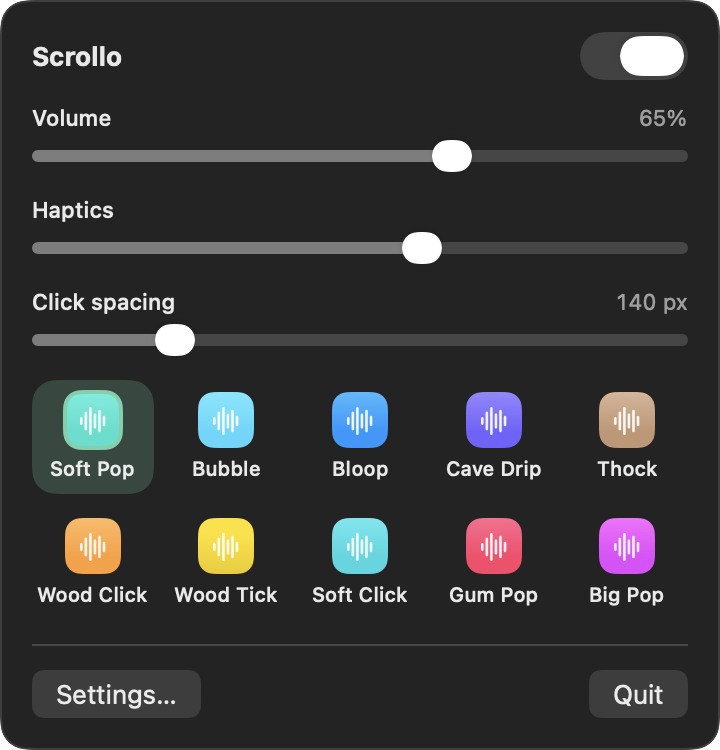
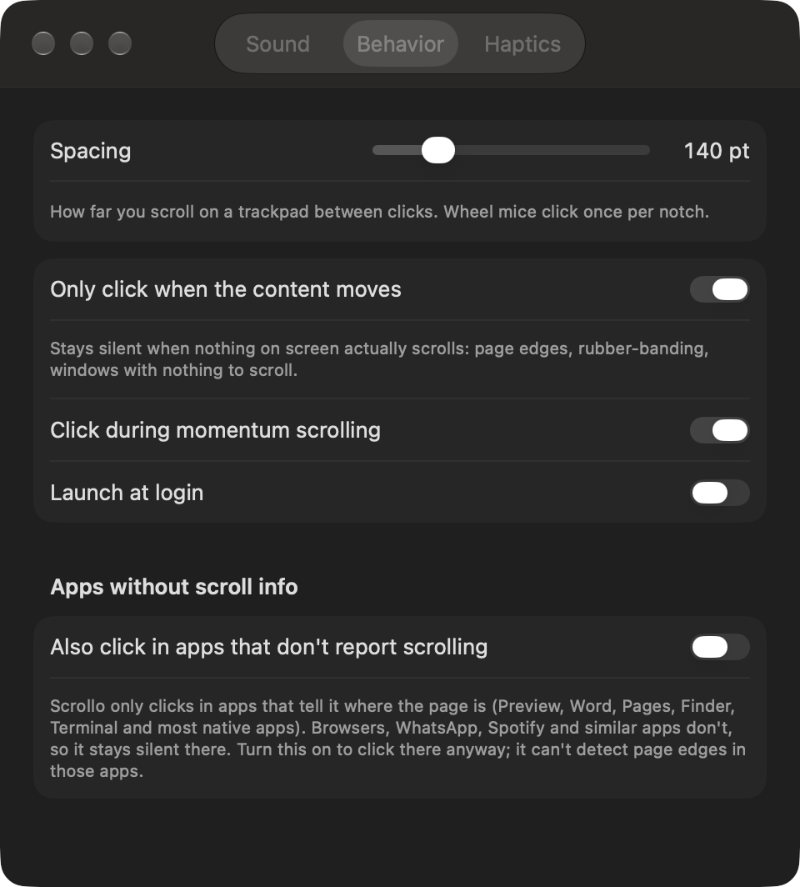
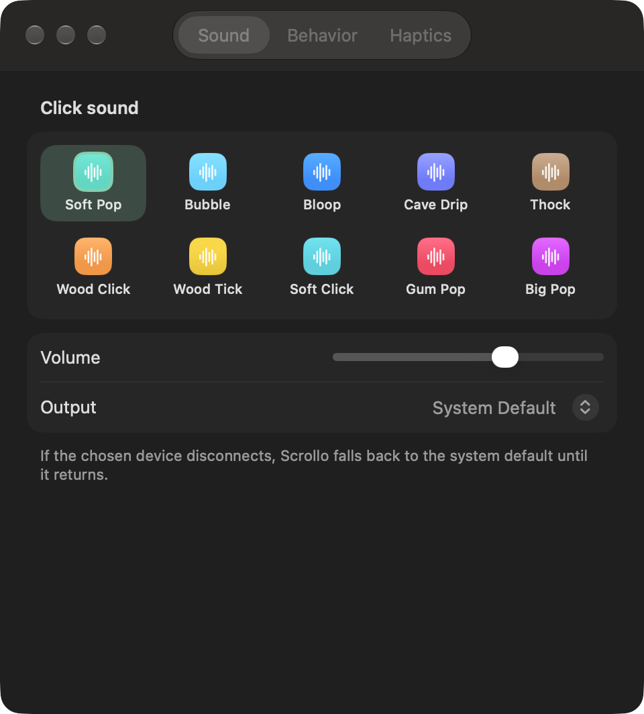
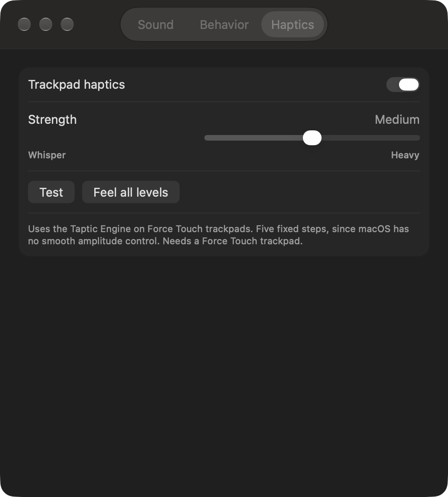
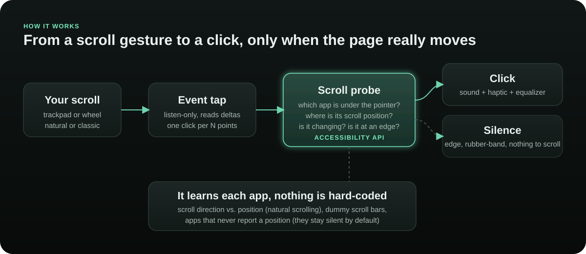

<div align="center">



<br>

[](#requirements)
[](#requirements)
[](#build-from-source)
[](LICENSE)
[](https://github.com/pushpam2404/scrollo/releases/latest)
[](https://github.com/pushpam2404/scrollo/actions)

**Scrollo is a free, open-source macOS menu bar app that plays a satisfying click, and optionally taps your trackpad, every time you scroll past a notch.**

[Download](https://github.com/pushpam2404/scrollo/releases/latest) · [Install](#install) · [How it works](docs/HOW_IT_WORKS.md) · [Troubleshooting](docs/TROUBLESHOOTING.md) · [Contributing](CONTRIBUTING.md)

</div>

---

> **Scrollo is a native Mac app.** It runs only on macOS 14 (Sonoma) or later. It is not available for Windows, Linux, iOS or the web.

## Why Scrollo

Scrolling on a Mac is silent and weightless. Scrollo gives it a physical feel: a soft click as the pointer crosses each notch and a matching tap from the Taptic Engine.

It is also **careful about when it clicks**. Most scroll-sound tools fire on every finger movement. Scrollo asks the app under your pointer whether the content is actually moving, so it stays quiet at the top or bottom of a page, while rubber-banding, and over windows with nothing to scroll.

## Features

| Feature | What it does |
|---|---|
| 🔊 **Ten click sounds** | Real recordings (wood, water, bubbles, thocks), trimmed and level-matched. Each click is pitch-varied slightly so fast scrolling never sounds machine-gunned. |
| 🛑 **Edge-aware** | Silent at the top and bottom of a page, during rubber-banding, and over the empty desktop. Learned per app, no hard-coded lists. |
| 🫳 **Trackpad haptics** | Five distinct strengths, from Whisper to Heavy, on Force Touch trackpads. |
| 🎚️ **Fully adjustable** | Volume, click spacing from 50 to 500 px, momentum scrolling on or off, per-device output (it falls back to the system default if a device disconnects). |
| ⚡ **Light on the system** | Idles at about 0% CPU. The audio engine pauses when you are not scrolling and wakes on demand. |
| 🔒 **Private by design** | No network access, no analytics, nothing recorded. See [Privacy](#privacy). |

## Screenshots

<div align="center">

&nbsp;&nbsp;

</div>

<br>

<details>
<summary><b>More settings screens</b></summary>
<br>
<div align="center">


</div>
</details>

## Install

### 1. Download

Get the latest **`Scrollo-x.y.z.dmg`** from the [Releases page](https://github.com/pushpam2404/scrollo/releases/latest). Open it and drag **Scrollo** into **Applications**.

### 2. Open it the first time

Scrollo is not notarized by Apple (that requires a paid developer account), so macOS will refuse to open it on the first try. This is a one-time step:

1. Double-click **Scrollo** in Applications. macOS shows a warning and does not open it.
2. Open **System Settings → Privacy & Security**, scroll to the **Security** section, and click **Open Anyway** next to "Scrollo".
3. Confirm with your password or Touch ID.

Prefer the terminal? This does the same thing:

```sh
xattr -dr com.apple.quarantine /Applications/Scrollo.app
```

### 3. Allow Accessibility

Scrollo needs **Accessibility** access to hear scroll events and to ask apps where their scroll position is. The first launch prompts for it; if you miss it:

**System Settings → Privacy & Security → Accessibility → turn on Scrollo**

It starts working immediately, with no relaunch. Look for the scroll-wheel icon in your menu bar.

### Requirements

- macOS 14 Sonoma or later (Apple Silicon or Intel)
- A Force Touch trackpad for haptics (everything else works with any mouse or trackpad)

## Using Scrollo

Click the menu bar icon for the quick panel: master switch, **Volume**, **Haptics** (the leftmost position is off), **Click spacing**, and the ten sounds. Click a sound to hear it. **Settings…** has the rest: output device, momentum scrolling and launch at login.

## Where it clicks

Scrollo can only judge an app that reports its scroll position, so behavior depends on the app:

| Group | Apps | Behavior |
|---|---|---|
| ✅ **Full edge detection** | Preview, TextEdit, Finder, Terminal, Microsoft Word. Most native Mac apps with scroll bars are expected to behave the same. | Clicks while the content moves; silent at edges and when nothing scrolls. |
| 🔇 **Silent by default** | Browsers (Brave, Chrome, Edge, Arc, ...) and web-based apps (for example Spotify and WhatsApp). | They do not report where the page is, so Scrollo cannot tell when you reach the end. Rather than click at the wrong times, it stays quiet. |

Want clicks in those apps anyway? Turn on **Settings → Behavior → Also click in apps that don't report scrolling**. It will click while you scroll but cannot detect page edges there.

The "Full edge detection" list is what was tested during development. If an app misbehaves, please [open an issue](https://github.com/pushpam2404/scrollo/issues/new/choose).

## How it works

<div align="center">

</div>

A listen-only event tap reads scroll deltas. For each potential click, a probe finds the scroll area under the pointer and reads its position through the macOS Accessibility API. If the position is changing, Scrollo clicks. If you are pushing against an edge, or nothing moves, it stays silent. It learns the relationship between scroll direction and position per app, so it works the same with natural scrolling on or off.

Read the full write-up in **[docs/HOW_IT_WORKS.md](docs/HOW_IT_WORKS.md)**.

## Privacy

- Scrollo makes **no network connections** and has no telemetry or update checker.
- It reads scroll events only to time the click; it does not log keystrokes, mouse positions or screen contents.
- Settings are stored locally in your user preferences.
- A small diagnostic log is written to `~/Library/Logs/Scrollo.log` (verdicts such as "app X: silent, at edge"). Delete it any time.
- It does not use Screen Recording or Input Monitoring.

## Build from source

You need the Xcode Command Line Tools (`xcode-select --install`). Full Xcode is not required.

```sh
git clone https://github.com/pushpam2404/scrollo.git
cd scrollo
./build.sh                 # builds and installs to ~/Applications
open ~/Applications/Scrollo.app
```

Other scripts:

| Script | What it does |
|---|---|
| `./build.sh --no-install` | Build `build/Scrollo.app` only. |
| `./scripts/package.sh` | Build a universal (arm64 + x86_64) app and write a DMG and ZIP to `dist/`. |
| `./scripts/render-docs.sh` | Re-render the UI screenshots from the real SwiftUI views. |
| `./scripts/render-banners.sh` | Re-render the README banner images. |

> **Tip for developers:** macOS ties the Accessibility grant to the app's code signature. An ad-hoc signed build loses the grant on every rebuild. [docs/DEVELOPMENT.md](docs/DEVELOPMENT.md) shows how to create a free local signing certificate so the grant survives rebuilds.

## Project layout

```
Sources/      The app (Swift, SwiftUI + AppKit)
  ScrollMonitor.swift   event tap, click timing
  ScrollProbe.swift     is the content under the pointer really moving?
  AudioPlayer.swift     low-latency audio engine, output device handling
  SoundBank.swift       the ten bundled sounds
  Haptics.swift         five-level trackpad taps
  Settings.swift, Views.swift, main.swift
Resources/Sounds/       CC0 click sounds + credits
icon/                   app icon generator
Tools/, scripts/        docs renderer, build and packaging scripts
docs/                   guides and images
```

## FAQ

<details><summary><b>It does not click. What should I check?</b></summary>

1. Is Scrollo switched on in the menu bar panel, and is the volume above zero?
2. Is **Accessibility** enabled for Scrollo? (If you rebuilt it yourself, remove and re-add it.)
3. Are you in an app on the [silent list](#where-it-clicks)? Try Preview or Finder.
4. Check your Mac's output device and that it is not muted.

More in [docs/TROUBLESHOOTING.md](docs/TROUBLESHOOTING.md).
</details>

<details><summary><b>Why does it stay silent in my browser?</b></summary>

Browsers do not expose their scroll position to other apps, so Scrollo cannot tell when a page has reached its end. Silence is the safe default. You can opt in to clicks everywhere in Settings → Behavior.
</details>

<details><summary><b>Do I need a trackpad with haptics?</b></summary>

No. Haptics are optional and need a Force Touch trackpad or Magic Trackpad 2. Sounds work with any mouse or trackpad.
</details>

<details><summary><b>Is it safe? Why the "Open Anyway" step?</b></summary>

The source is all here and builds with one command. The warning appears because the release is not notarized by Apple, which needs a paid developer account. If you prefer, build it yourself.
</details>

<details><summary><b>Will there be an App Store version?</b></summary>

Unlikely: Scrollo needs Accessibility access and uses Apple's private MultitouchSupport framework for the five haptic strengths (it falls back to a public API if that is unavailable), which the App Store does not allow.
</details>

## Contributing

Issues and pull requests are welcome. Start with [CONTRIBUTING.md](CONTRIBUTING.md). Changes are listed in [CHANGELOG.md](CHANGELOG.md).

## Credits & license

- Code: [MIT](LICENSE).
- Click sounds: CC0 recordings from [Freesound](https://freesound.org), credited in [Resources/Sounds/CREDITS.txt](Resources/Sounds/CREDITS.txt).
- Scrollo is an independent project and is not affiliated with Apple.

<div align="center"><sub>Made for Mac. If Scrollo makes scrolling a little more fun, a ⭐ helps others find it.</sub></div>
