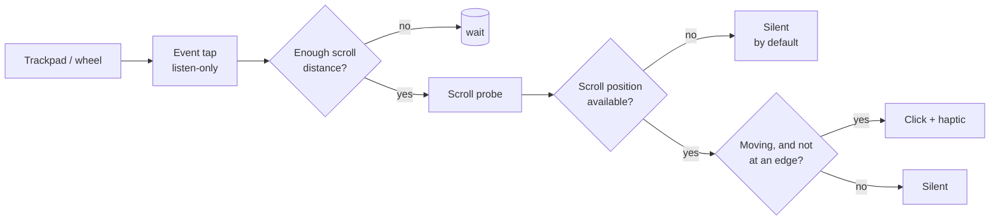

# How Scrollo works

Scrollo does two jobs: **time a click to your scrolling**, and **decide whether the page is really scrolling** so it can stay quiet at edges. The second job is where most of the engineering is.

## 1. Event tap and click timing (`ScrollMonitor.swift`)

A listen-only `CGEventTap` receives every scroll-wheel event. It never modifies or blocks events.

- **Trackpads** (continuous scrolling): point deltas accumulate, and a click fires every *N* points, where *N* is the **Click spacing** setting (50 to 500 px). At most three clicks fire per event, so a violent flick does not machine-gun.
- **Wheel mice**: one click per notch (line delta).
- **Momentum**: the OS keeps sending events after your fingers lift; **Click during momentum scrolling** controls whether those click.
- The tap is re-enabled automatically if macOS disables it (timeout or user input) and after the Mac wakes.

The event only starts the decision. The click itself is gated by the scroll probe.

## 2. The scroll probe (`ScrollProbe.swift`)

For each decision the probe finds out what is under the pointer and whether it is really scrolling. All Accessibility work happens on one background queue so the main thread is never blocked, and at most one sample is queued at a time, so a slow app cannot build up a backlog.

### Finding the scroll area

1. Hit-test the pointer position with the Accessibility API and walk up the parents to the nearest `AXScrollArea`.
2. Some elements have a broken parent chain (for example the text layer of a PDF in Preview). In that case the probe searches the element's window instead, descending only into children whose frames contain the pointer.
3. The result is cached while the pointer stays inside the same area and that app's window is still on top.

### Reading the position

| Source | When | How |
|---|---|---|
| **Scroll bar** | Most native apps | The vertical bar's `AXValue` (0 to 1). A bar must be enabled and have a real frame: Word, for one, exposes a zero-size dummy bar that never moves, and it is rejected. |
| **Content frame** | No usable bar (Word) | The position of one element of the scrolled content, read through the scroll area's `AXVisibleChildren`. Only trusted for apps that publish visible children (which implies the list is kept current) or that have been seen to move. |
| **Nothing** | Chromium browsers, Electron/web apps | No position is available, so Scrollo does not click (see below). |

Chromium-based browsers are **never queried**. Probing them switches on their full accessibility mode, which has side effects, and they do not report scroll position anyway.

### Learning the direction

macOS reports scroll deltas differently depending on the natural-scrolling setting, and apps disagree about whether a scroll bar's `1.0` is the top or the bottom. Scrollo therefore **learns** the mapping from the app itself: when a scroll in direction *d* is followed by the bar value changing by *Δ*, it records `sign(Δ) × d`. Two agreeing observations fix it, and it is remembered per app and per device type (trackpad or mouse) in your preferences.

### Deciding

A click is allowed when the content is moving and silenced when:

- the bar is at an end *and* you are pushing further in that direction (using the learned direction), or
- the position has not changed for a quarter of a second of scrolling (nothing is scrolling there, or you are rubber-banding), or
- the spot is remembered as blocked for that direction. When a gesture goes nowhere, Scrollo remembers "pushing this way here does nothing", so the next flick at the same edge is silent immediately.

Position reports lag the real scroll a little, so the decision never relies on instantaneous movement. Lookups that time out (a busy app) do not throw away the last good answer.

Also silent: the empty desktop (detected from the window list, which needs no permission).

## 3. Audio (`AudioPlayer.swift`, `SoundBank.swift`)

- Each sound is a short WAV loaded into memory with three slightly pitch-shifted variants (about ±4%).
- Eight player nodes are used round-robin on one `AVAudioEngine`, so overlapping clicks do not cut each other off.
- The engine pauses after six idle seconds (about 0% CPU) and wakes on demand. Every player node is re-armed after each engine restart, because a node can report `isPlaying` after a restart while producing no sound.
- The output follows the system default; a specific device can be chosen, and Scrollo falls back to the default if it disappears. Device change notifications arrive in bursts, so they are debounced.

## 4. Haptics (`Haptics.swift`)

Five levels (Whisper, Light, Medium, Firm, Heavy) are produced with the trackpad's actuator through Apple's private `MultitouchSupport` framework, loaded dynamically and checked symbol by symbol. If anything is missing it falls back to the public `NSHapticFeedbackManager` (which offers only three patterns).

## Limitations

- Apps that do not expose a scroll position (browsers, web-based apps) cannot be judged and stay silent unless you opt in to clicking everywhere.
- The first time you reach an edge in an app, you may hear one click or two (up to a quarter second) before Scrollo has seen the position stop.
- The Accessibility grant is tied to the app's code signature (see [DEVELOPMENT.md](DEVELOPMENT.md)).
